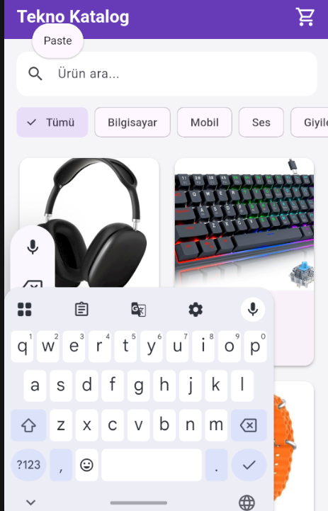

# Mini Katalog Uygulaması

Flutter kullanılarak geliştirilen basit bir teknoloji ürünleri katalog uygulamasıdır. Uygulamada ürünler kart yapısıyla listelenebilir, aranabilir, kategorilere göre filtrelenebilir ve ürün detayları görüntülenebilir.

## Özellikler

- Ürünleri GridView ile kart şeklinde listeleme
- Ürün adına göre arama
- Kategoriye göre filtreleme
- Ürün detay sayfası
- Sayfalar arasında ürün verisi aktarımı
- Sepete ürün ekleme simülasyonu
- Sepetteki ürün sayısını gösteren sayaç
- JSON verilerini model nesnesine dönüştürme
- `fromJson` ve `toJson` kullanımı
- İnternet üzerinden ürün görsellerini gösterme
- Material Design arayüzü

## Kullanılan Teknolojiler

- Flutter
- Dart
- Material Design
- JSON veri modelleme

Ekstra Flutter paketi kullanılmamıştır.

## Proje Yapısı

```text
lib/
├── main.dart
├── data/
│   └── product_data.dart
├── models/
│   └── product.dart
├── pages/
│   ├── product_list_page.dart
│   └── product_detail_page.dart
└── widgets/
    └── product_card.dart
```

- `main.dart`: Uygulamayı başlatır ve tema ayarlarını içerir.
- `data`: Ürünlere ait örnek JSON verilerini içerir.
- `models`: Product veri modelini ve JSON dönüşüm metotlarını içerir.
- `pages`: Ürün listesi ve ürün detay ekranlarını içerir.
- `widgets`: Tekrar kullanılabilir ürün kartı bileşenini içerir.

## Flutter Sürümü

Projede kullanılan Flutter sürümünü görmek için:

```bash
flutter --version
```

Flutter sürümü: `Flutter 3.47.1`

## Kurulum ve Çalıştırma

### 1. Projeyi klonlayın

```bash
git clone https://github.com/bugraberatkok/mini-katalog-flutter.git
```

### 2. Proje klasörüne girin

```bash
cd mini_katalog
```

### 3. Flutter bağımlılıklarını yükleyin

```bash
flutter pub get
```

### 4. Emulatorü veya fiziksel Android cihazı başlatın

Bağlı cihazları kontrol etmek için:

```bash
flutter devices
```

### 5. Uygulamayı çalıştırın

```bash
flutter run
```

## Uygulamanın Kullanımı

1. Ana sayfada teknoloji ürünleri listelenir.
2. Arama alanından ürün adına göre arama yapılabilir.
3. Kategori seçenekleri kullanılarak ürünler filtrelenebilir.
4. Ürün kartına dokunulduğunda detay sayfası açılır.
5. Detay sayfasındaki **Sepete Ekle** butonuyla sepet sayacı artırılır.

## JSON Yapısı

Ürün verileri JSON benzeri `Map<String, dynamic>` yapısında tutulmaktadır. Bu veriler `Product.fromJson()` metodu kullanılarak `Product` nesnelerine dönüştürülmektedir.

```dart
final List<Product> products = productJsonData
    .map<Product>((json) => Product.fromJson(json))
    .toList();
```

`Product.toJson()` metodu ise bir ürün nesnesini yeniden JSON yapısına dönüştürmek için kullanılabilir.

## Ekran Görüntüleri

### Ürün Listesi


### Ürün Detayı


### Arama ve Filtreleme



## Geliştirici

**Buğra Berat Kök**